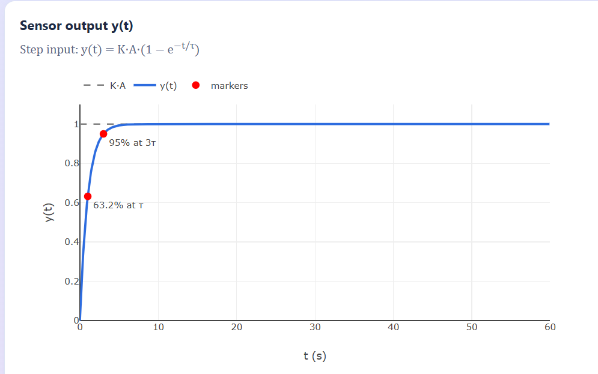
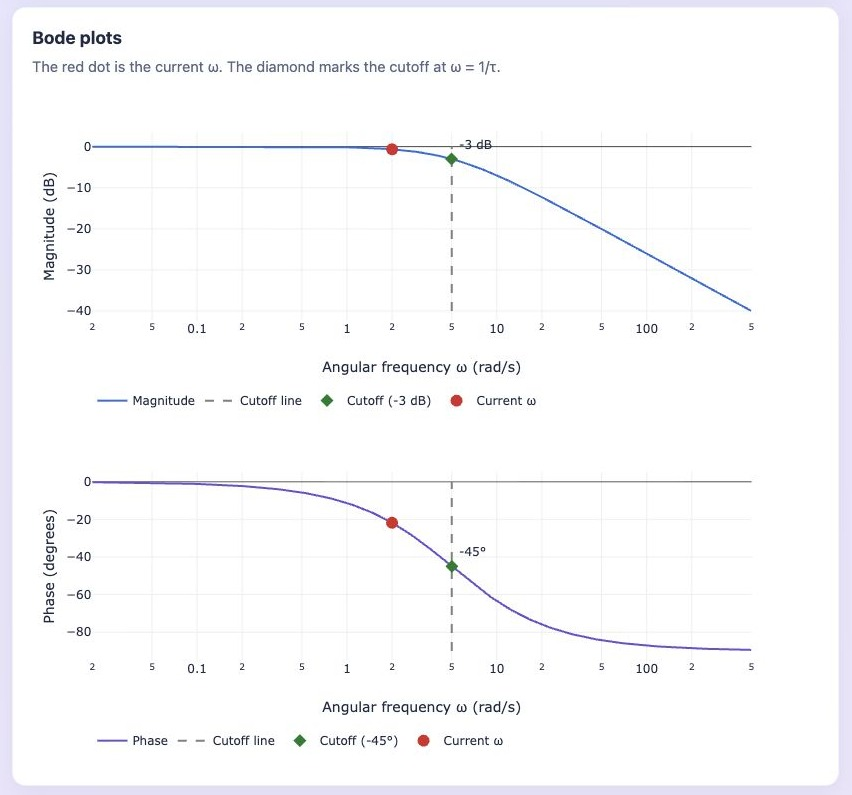
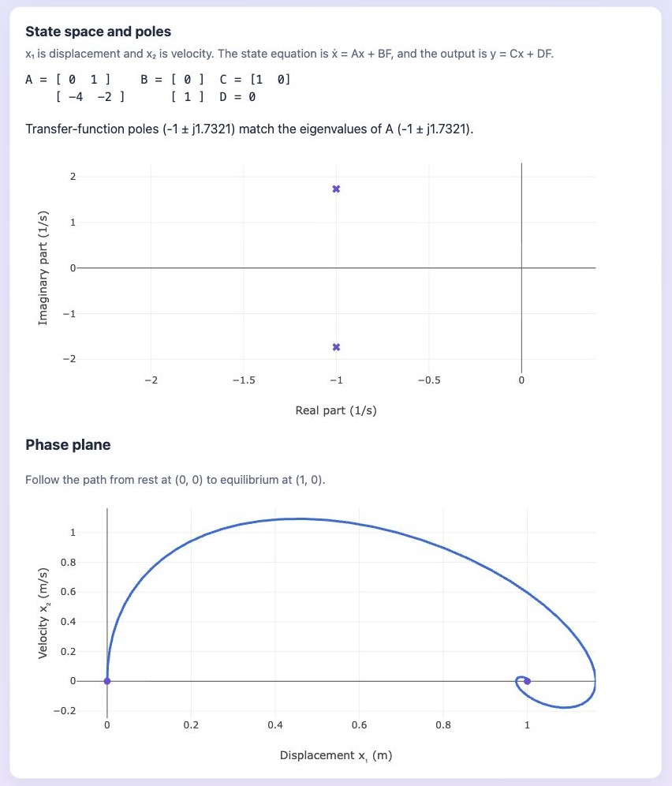
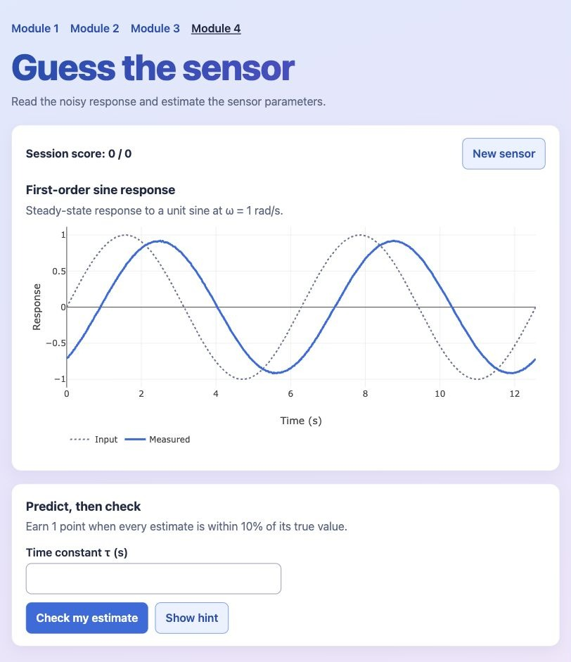
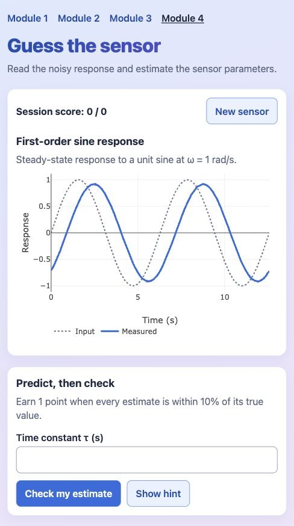

# Dynamic Characteristics Toolkit

ENCS4380 Interfacing Techniques · Homework 1 and 2 · Team 28 · Birzeit University

[Open the toolkit](https://ramaalrob.github.io/encs4380-dynamics-T28/). To run it locally, open `index.html` in a browser with internet access for Plotly.

## Modules and contributions

| Module | What to try | Team contribution |
| --- | --- | --- |
| [1. First-order time response](index.html) | Adjust gain and time constant. Compare step and ramp inputs, inspect the log-error plot, and check your predictions. | Rama (@RamaAlrob) |
| [2. First-order frequency response](module2.html) | Change input frequency to see attenuation and phase lag. Use the Bode plots and find the maximum time constant for 5% amplitude error at 100 Hz. | Mariam Qadah (@1231974-code) |
| [3. Second-order response](module3.html) | Adjust mass, damping, and stiffness. Compare rise time, overshoot, and settling time with the poles, phase plane, and state-space model. | Juman (@Juman2005) |
| [4. Guess the sensor](module4.html) | Estimate τ, or ζ and ωₙ, from a noisy response. Submit to reveal the clean curve and earn a point when every estimate is within 10%. | Juman (@Juman2005) implemented the module, with contributions from Rama and Mariam. |

Module 1 checks the 63.2% and 95% step-response markers, log-error slope, ramp lag, and steady-state error. The original slider sweep passed all 6,084 validation rows. Module 3 shows homework checks 4 through 6 and compares state-space eigenvalues with the plotted poles.

## Screenshots

| Module | Preview |
| --- | --- |
| 1 · Step response |  |
| 2 · Bode plots |  |
| 3 · State space and poles |  |
| 4 · Guess the sensor |  |
| 4 · Phone view (390 px) |  |

More from Module 1 · [Ramp](ramp.png) · [Log-error plot](error-log.png) · [Prediction exercise](predict.png) · [Phone view](phone.png)

## AI use

AI tools assist with explanations, coding, and review.

## Homework 2 · Control lab

Open the [live Control lab](https://ramaalrob.github.io/encs4380-dynamics-T28/control.html) or select Control from the landing page. The lab runs locally in the browser. Homework 2 module ownership is awaiting team confirmation.

| Module | Experiment | Owner |
| --- | --- | --- |
| [P1 · PID playground](control.html#p1) | Start with Kp = 9. Compare P, PI and PID, switch plant order and inspect the three reference checks. | Unassigned |
| [P2 · Slow sensor](control.html#p2) | Increase sensor τ from 0.02 s to 2 s. Compare the measured and true peaks and observe the oscillations. | Unassigned |
| [P3 · Digital PID](control.html#p3) | Compare short and long sample intervals, saturation and conditional integration. Copy the generated Arduino loop. | Unassigned |
| [P4 · Tuning challenge](control.html#p4) | Draw a hidden plant from Module 4’s first-order family and tune the gains to pass all three conditions. | Unassigned |

[My system](control.html#motor) starts with an illustrative drive motor, K = 1 RPM per percent PWM and τ = 1 s. Its target is 40 RPM. For PI control the characteristic polynomial is τs² + (1 + K Kp)s + K Ki. Setting Kp = 1/K and Ki = 1/(0.49 τ K) gives a nominal continuous damping ratio of 0.70. The plot tests this design with a sampled controller and forward-only PWM limits. The motor form accepts measured values and their source, stores them in the current browser and makes them available in P1–P3. The encoder scale and example pinout in the sketch need to match the actual hardware.

The solver integrates the first-order and mass–spring–damper dynamics with Euler steps. P1 and P2 differentiate the measurement to avoid a setpoint kick. P3 and My system use the homework’s sampled error difference, rectangular integral and zero-order hold. Control metrics are measured relative to the setpoint over the displayed run.
