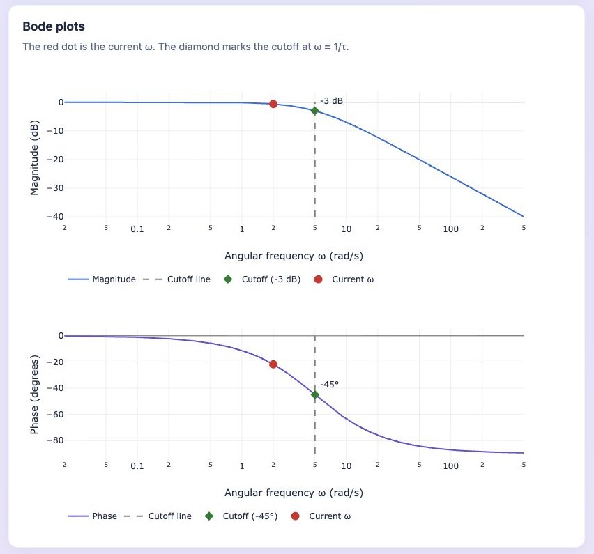
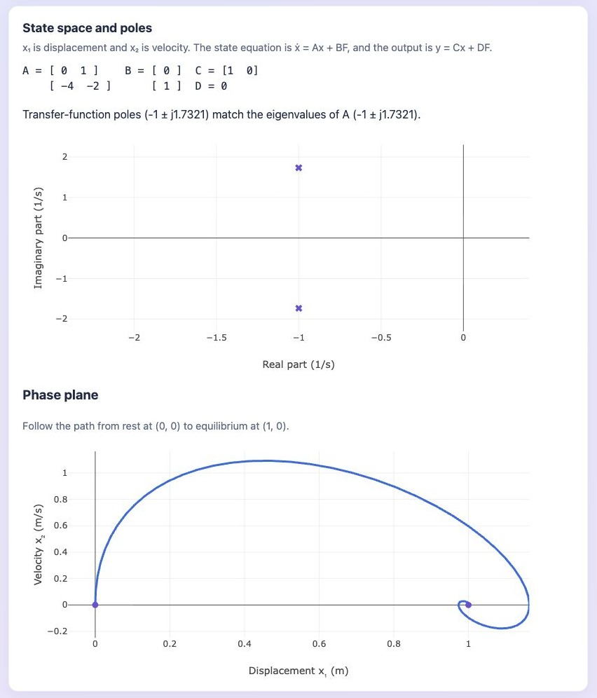
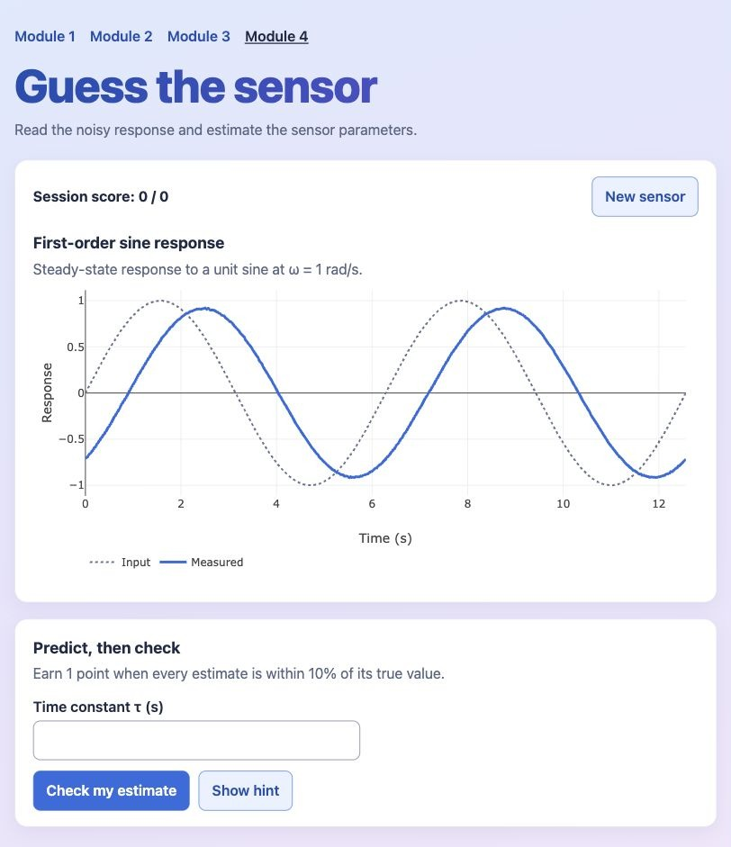
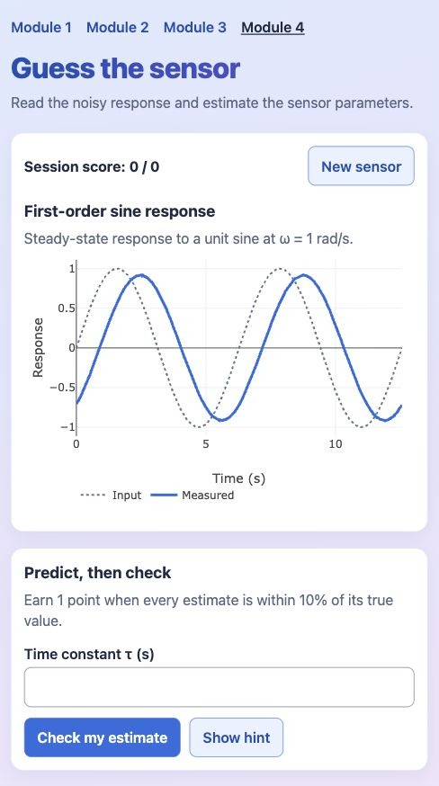

# Dynamic Characteristics Toolkit

ENCS4380 Interfacing Techniques · Homework 1 · Team 28 · Birzeit University

[Open the toolkit](https://ramaalrob.github.io/encs4380-dynamics-T28/). To run it locally, open `index.html` in a browser with internet access for Plotly.

## Modules and contributions

| Module | What to try | Team contribution |
| --- | --- | --- |
| [1. First-order time response](index.html) | Adjust gain and time constant. Compare step and ramp inputs, inspect the log-error plot, and check your predictions. | Rama (@RamaAlrob) |
| [2. First-order frequency response](module2.html) | Change input frequency to see attenuation and phase lag. Use the Bode plots and find the maximum time constant for 5% amplitude error at 100 Hz. | Mariam Qadah (@1231974-code) |
| [3. Second-order response](module3.html) | Adjust mass, damping, and stiffness. Compare rise time, overshoot, and settling time with the poles, phase plane, and state-space model. | Juman (@Juman2005) |
| [4. Guess the sensor](module4.html) | Estimate τ, or ζ and ωₙ, from a noisy response. Submit to reveal the clean curve and earn a point when every estimate is within 10%. | Juman (@Juman2005) implemented the module, with contributions from Rama and Mariam. |

Module 1 checks the 63.2% and 95% step-response markers, log-error slope, ramp lag, and steady-state error. The original slider sweep passed all 6,084 validation rows. Module 3 shows homework checks 4 through 6 and compares state-space eigenvalues with the plotted poles.

## Screenshots

| Module | Preview |
| --- | --- |
| 1 · Step response |  |
| 2 · Bode plots |  |
| 3 · State space and poles |  |
| 4 · Guess the sensor |  |
| 4 · Phone view (390 px) |  |

More from Module 1 · [Ramp](ramp.png) · [Log-error plot](error-log.png) · [Prediction exercise](predict.png) · [Phone view](phone.png)

## AI use

Claude helped explain the Module 1 math, write and review code, and build the headless validation test. Codex helped implement Modules 3 and 4 and check response formulas, state-space eigenvalues, challenge scoring, and phone layout.
