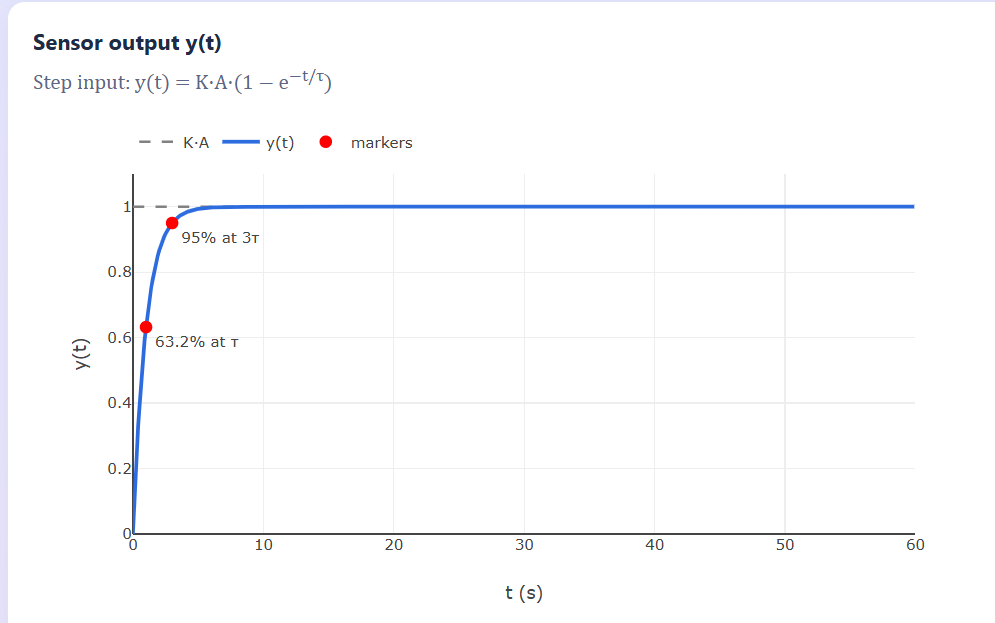
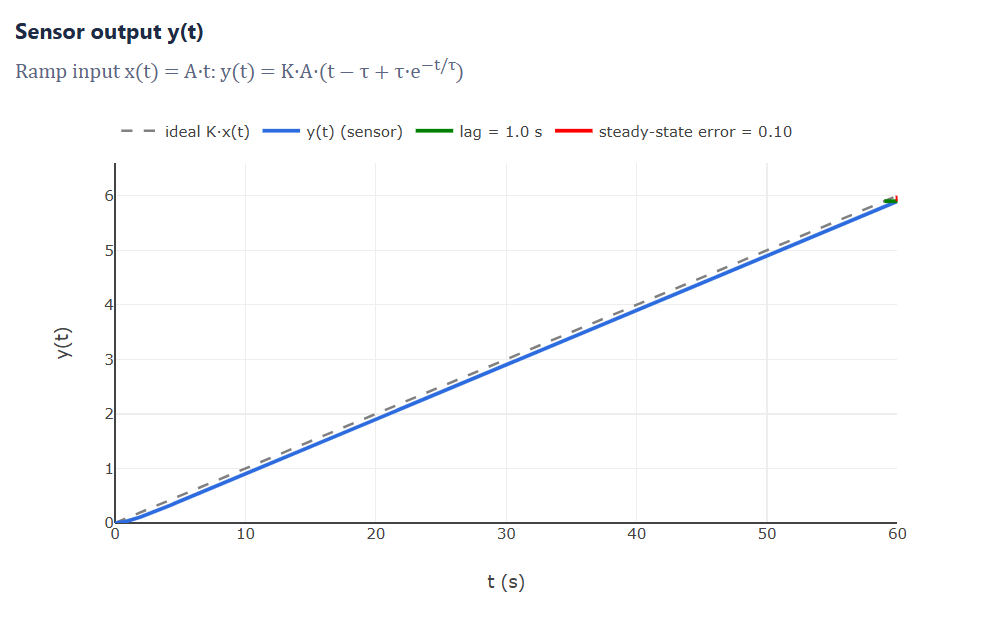
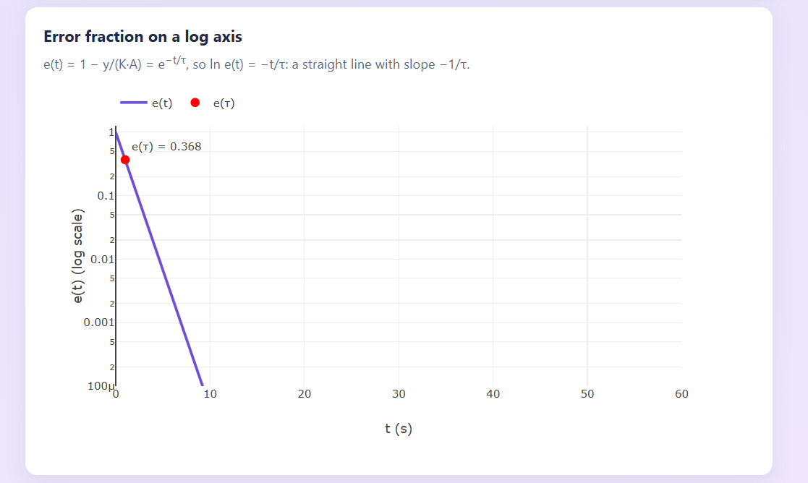
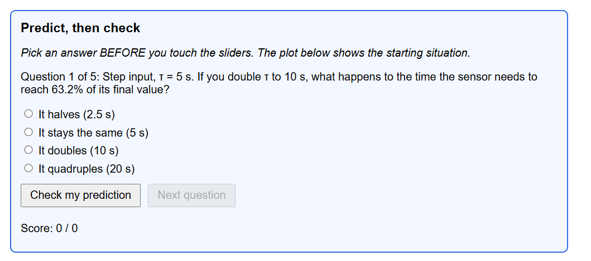
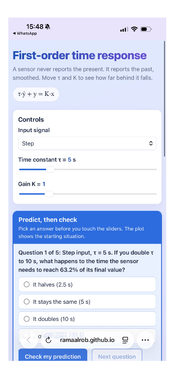

# ENCS4380 Homework 1: Dynamic Characteristics Toolkit

Birzeit University, ENCS4380 Interfacing Techniques (Dr. Wasel Ghanem)

**Group:** T28

**Live page:** https://ramaalrob.github.io/encs4380-dynamics-T28/

## Team

| Member | Responsibility | GitHub Issue |
|---|---|---|
| Rama (@RamaAlrob) | Module 1: First-order time response; part of Module 4 | #1 |
| Mariam Qadah (@1231974-code) | Module 2: First-order frequency response; part of Module 4 | Opens with Module 2 |
| Juman (@Juman2005) | Module 3: Second-order response, including the state-space panel | Opens with Module 3 |
| Everyone | Validation checks, final integration, README | Opens before final release |

## Status

- [x] Module 1: First-order time response
- [ ] Module 2: First-order frequency response
- [x] Module 3: Second-order response + state-space panel
- [ ] Module 4: Guess the sensor

---

## Module 1: First-order time response

### What the module shows

A first-order sensor (for example a thermometer) is modelled by

τ·ẏ + y = K·x

where τ is the time constant (how slow the sensor is), K is the gain (how much output it gives per unit of input), and x is the input.

The page lets the user change:

| Control | Range | What it does |
|---|---|---|
| Input | Step or Ramp | Chooses the input signal |
| τ | 1 to 20 s | Speed of the sensor |
| K | 0.5 to 3 | Gain (final value) |

The time axis is fixed at 0 to 60 s on purpose, so that making τ larger visibly slows the curve down instead of the plot rescaling itself.

### Step input (A = 1)

y(t) = K·A·(1 − e^(−t/τ))

The plot shows:

- the curve y(t) and a dashed line at the final value K·A,
- a marker at t = τ (63.2% of K·A) and a marker at t = 3τ (95% of K·A),
- a second plot of the error fraction on a log axis (see below).

### Ramp input (x = A·t, with A = 0.1 units per second)

y(t) = K·A·(t − τ + τ·e^(−t/τ))

The plot shows the ideal (no delay) output K·A·t as a dashed line, the real sensor output, a green horizontal segment for the lag and a red vertical segment for the steady-state error. Both are measured at the right end of the plot (t = 60 s).

### Error fraction on a log axis (step only)

e(t) = 1 − y/(K·A) = e^(−t/τ), so ln e(t) = −t/τ

On a log axis this is a straight line with slope −1/τ. This is the method used later to estimate τ from a curve (Module 4). K cancels out of e(t), so moving K does not change this plot. Values below 1e-6 are skipped because a log axis cannot draw zero.

### Predict, then check

A box above the plot asks 5 questions (3 for the step, 2 for the ramp). The page first sets the sliders to a starting situation. The user picks an answer, presses "Check my prediction", and only then does the page move the sliders to the new situation so the user can compare the result with their guess. A score is kept for the session. The sliders are not locked while a question is open.

### Validation checks (shown live on the page)

| Mode | Check | Expected |
|---|---|---|
| Step | y(τ) / KA | 0.632 |
| Step | y(3τ) / KA | 0.950 |
| Step | Error fraction e(τ) | 0.368 |
| Step | Slope of ln e(t), measured between t = τ and t = 3τ | −1/τ |
| Ramp | Lag time | τ |
| Ramp | Steady-state error | K·A·τ |

The ramp checks are evaluated at t = 10τ, where the transient term τ·e^(−t/τ) has fully died out (this is what "steady state" means). Each row shows expected value, our value, and PASS or FAIL.

Tested by running the page logic over every slider combination (τ from 1 to 20 in steps of 0.5, K from 0.5 to 3 in steps of 0.1, both modes): 6084 check rows, 0 failures.

The lecture checks 2 to 6 will be added with Modules 2 and 3.

### What I understood

1. A sensor reports the past, smoothed. It moves faster when it is far from the true value and slower as it gets close, so it approaches the final value but never reaches it exactly. That behaviour is the exponential 1 − e^(−t/τ).
2. τ is a speed rating, defined as the time to reach 63.2% of the way. The number is not chosen, it comes out of the maths: at t = τ the exponent is −1 and 1 − e^(−1) = 0.632. At t = 3τ, 1 − e^(−3) = 0.950. Reading the sensor before about 3τ gives a wrong value even if the sensor is perfectly calibrated.
3. K and τ do different jobs. K sets how high the curve ends (K·A). τ sets how fast it gets there. Changing K does not change the time to reach 63.2% of the final value, and changing τ does not change the final value.
4. A ramp shows the delay most clearly. After the start-up transient, the sensor follows a line parallel to the input but shifted right by exactly τ seconds. That horizontal gap is the lag (= τ). The vertical gap is the steady-state error K·A·τ, because the sensor is τ seconds behind an input that grows K·A per second. A slower sensor (bigger τ), a faster ramp, or a bigger K all make this error larger, and waiting longer does not remove it.
5. The log plot turns a curve into a line. Taking ln of e^(−t/τ) gives −t/τ, so the slope is −1/τ and τ can be measured from the slope alone, without knowing the final value precisely. A steep line means a small τ (fast sensor), a shallow line means a large τ (slow sensor).
6. Validation is how we trust the code. We code the formula and then check it against the known numbers from the lecture (63.2%, 95%, lag = τ, error = K·A·τ).

## Module 3: Second-order response and state space

Open [Module 3](module3.html) from the toolkit navigation. Adjust mass, damping,
and stiffness, or select a damping preset. The mass starts from rest and the
force steps to k newtons, giving a final displacement of 1 m. The same model
drives the step plot, pole plot, and displacement–velocity phase plane.

The step plot marks the first 10% and 90% crossings, the first peak when one
exists, and the final entry into the ±2% settling band. The state-space panel
shows the live matrices and compares the eigenvalues of A with the poles.
The validation table covers homework checks 4–6.

## How to run

Open the live page link above, or open index.html in a browser (an internet connection is needed to load Plotly from the CDN).

## AI use

An AI assistant (Claude) was used while building this module: to explain the maths step by step, to write and review the code with us, and to build the headless test that checked all validation rows.

Codex helped implement Module 3 and check its response formulas, metrics, and
state-space eigenvalues against the homework examples.

## Screenshots

Step response with the 63.2% (at τ) and 95% (at 3τ) markers:

Ramp response with the lag (= τ) and the steady-state error (= K·A·τ):

Error fraction on a log axis (a straight line with slope −1/τ):

The "Predict, then check" box:

Phone view (390 px):

